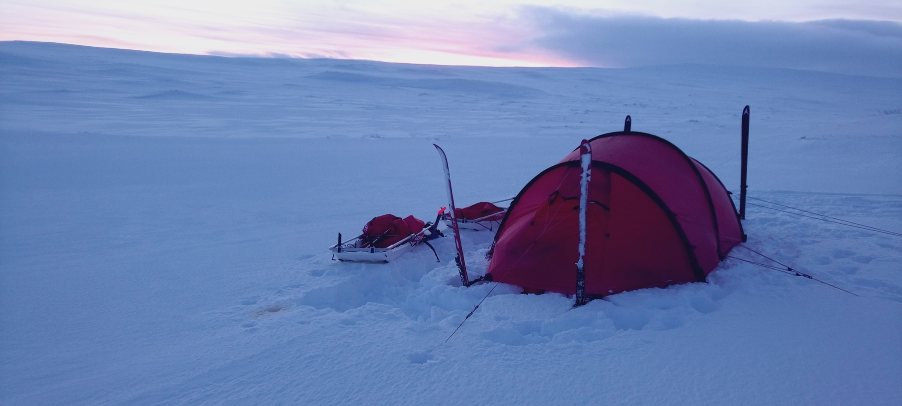

Most nights are in the tent. The Jämtland huts are still closed in February, so the first stretch is camping even when the ski passes a station. From Ritsem to Abisko the nights are in huts. The sleep kit is the same either way.

*Hardangervidda, 4 March 2026.*

The weights below are the same catalog figures as in [Gear at the start of section 1](/posts/2026-10-16-section-1-start-gear/).

## Tent

We have had a Hilleberg Nallo 3 GT tent for over 6 years. We've used it for family camping by car and bike and on a hike. On last years trip crossing the Hardangervidda, we camped in it twice. Its a great tent for 2 people, but its really too small for 3. For one its luxurious. It is a tunnel, so it is pitched with the door end toward the wind. It is not freestanding. I have used many free standing tents in the past, but genrally don't see that much of an advantage, you still have to stake out the tent.

 For this journey I decided to upgrade to a **Hilleberg Nammatj 3 GT.** This is a Black Label tent, using Kerlon 1800 cloth, and weighs about **4.1 kg** packed. The **Nallo 3GT** is the same shape in a lighter fabric, about **3.1 kg**. The difference in the stronger cloth and poles. That kilo make it a February tent. The Nammatj also has the ventilation opening at the foot end higher then the Nallo. When covered in snow it wil ventilate better.

The 3-person inner is the reason for this tent rather than a 2. A 2-person inner is tight for that. The GT vestibule holds the stove, the melt water, and the kit that stays wet.

### On the pulk

The tent lives in a **Hilleberg Sled Pack**, about **200 g**, **205 × 60 cm**. The poles stay half in their sleeves and the tent is folded around them, so pitching is pulling it open rather than feeding poles into a stuff sack. The pack is strapped on the pulk, not inside the cargo bag, and it comes off last. The hull is **144 cm** and the pack is **205 cm**, so the strap layout still needs a loaded try.

**Twelve or more** aluminium snow stakes, about **240 g** for the set. A guy line and the Hilleberg repair kit ride with them.

## Sleep

**Lowland K2 Expedition.** Mummy, **1,250 g** of 95% goose down, maker comfort **−35 °C**, about **1,995 g**. The bag is the warm part of the system. A cold night on snow comes from underneath.

**Exped Ultra 7R.** Down-insulated air pad, R-value **7.1**, about **855 g**, with its pump and a repair kit. This is the pad from Grövelsjön through Abisko.

**Sirex Everest 10.** Closed-cell foam, **185 × 50 cm**, **10 mm**, R-value **1.8**, about **275 g**. It goes under the air pad on the coldest nights, and it is the floor if the air pad punctures. It is not warm enough to replace the Ultra 7R in February. It rides flat in the main bag from day 1 to the end.

**NeoAir XLite.** Owned, R-value around **4**, about **400 g**. It is marginal on February snow, so it stays off the pulk. It can be picked up at Abisko and swapped in for the last stretch if April is mild. That saves about **450 g**. If it is not mild, the Ultra 7R stays in for the rest of the trip.

A light liner, about **150 g**, goes in the bag on hut nights.

## How it is packed

The bag and the Ultra 7R each go in a dry bag, then into a **Fjellpulken Sleeper 200**. The Sleeper is about **1.4 kg** empty, **200 × 67 cm**, and it is strapped on the pulk. Its fabric is not waterproof enough to skip the dry bags.

If the tent fails, the pad and the bag stay in the Sleeper and it zips up as a bivi. The stove stays outside. That is the backup. The Nallo does not come on the trip.

At camp the Sleeper comes off first and the sleep kit goes in the inner tent. Wet clothes, boots, and the stove stay in the vestibule. Nothing wet goes back against the down.

## The evening

Dig a pit in the vestibule for the stove. Cooking and melting stay in the vestibule, with the CO detector on.

Brush the snow off the jacket, the pants, and the boots before crawling in. A soft wide brush, the kind used on a car, so the snow comes off instead of being pushed into the cloth. It lives in the vestibule. That brush is still to buy.

Boots come off in the vestibule and the liners come out to air. Camp footwear is a pair of down booties over camp socks. Those booties are still to buy. The ski boots stay in the vestibule overnight.

Before sleep the bag gets fluffed. On a cold night the foam goes under the air pad. On a dry cold night the bag is vented.

## Still to try

Two or three winter nights in this tent, not the Nallo. Pitch it at dusk in gloves, with the pulk kit in the vestibule and the stakes in crust. Sleep at about **−15 °C** on the K2 and the Ultra 7R, with the foam under the hips, and once with the air pad deflated so the foam is the only floor.
